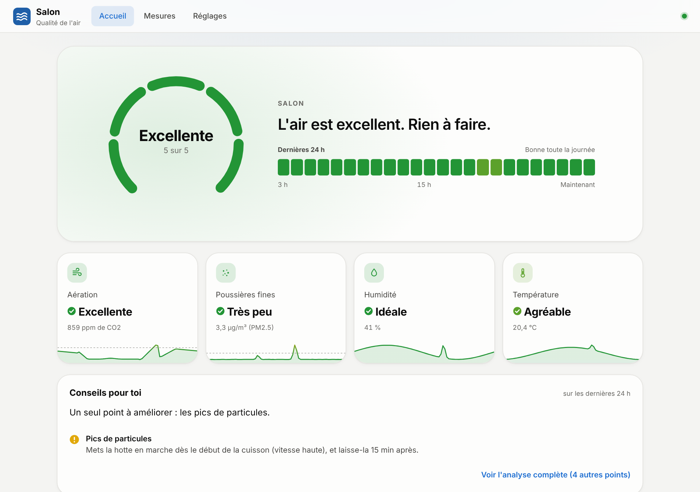
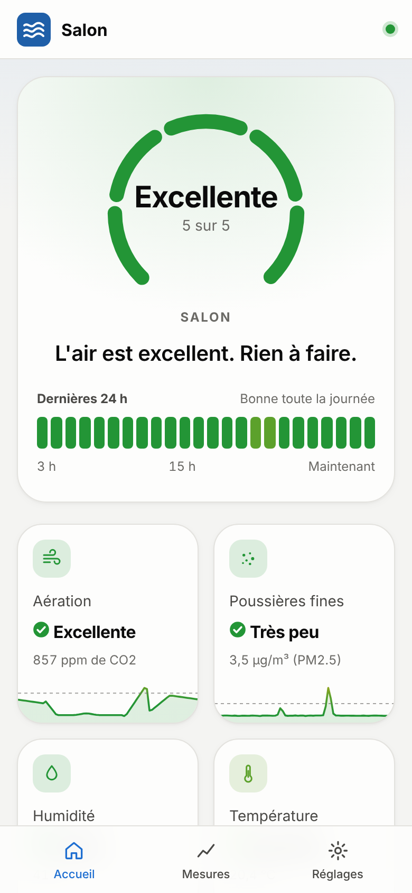
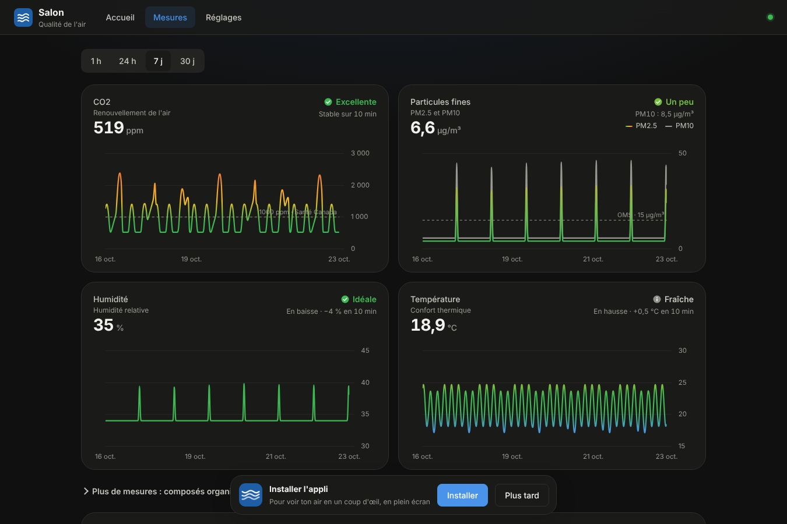
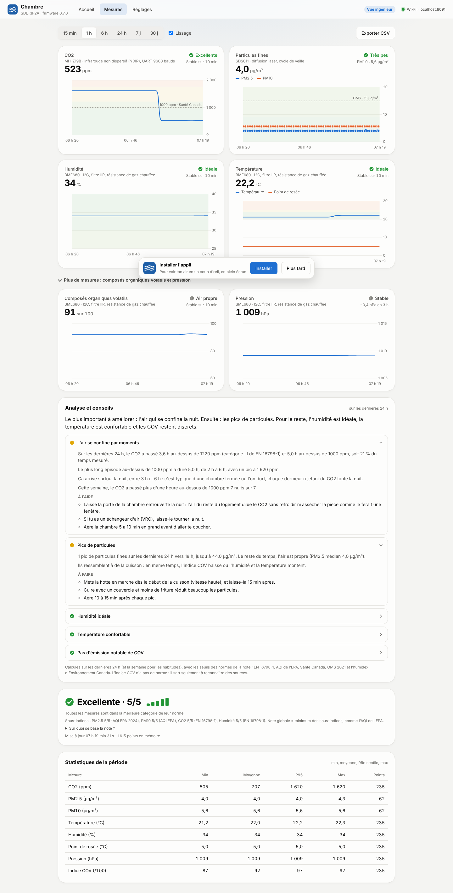
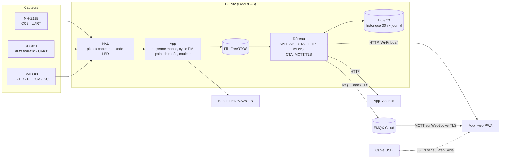
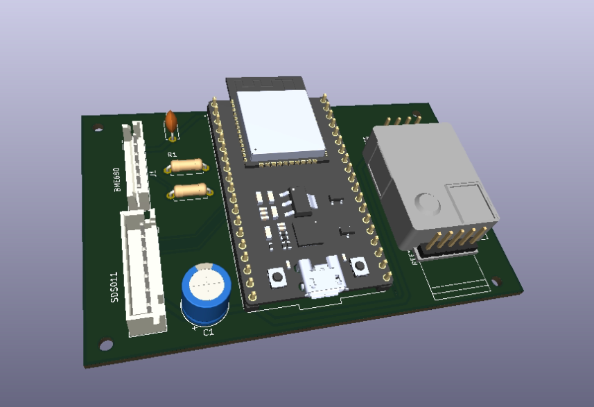
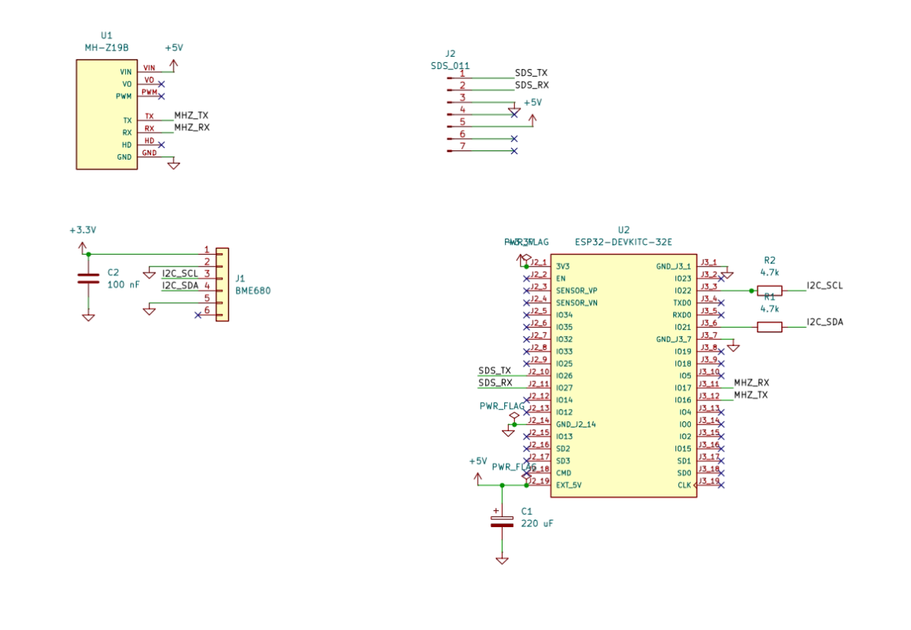
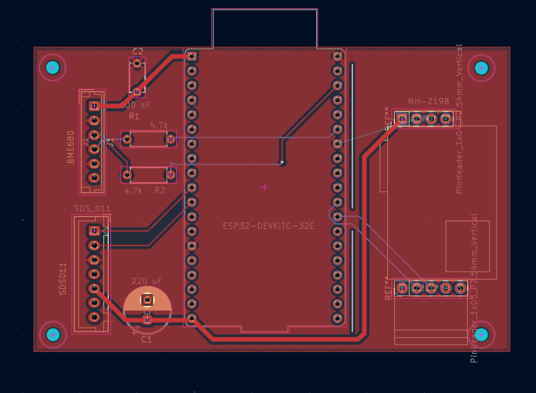
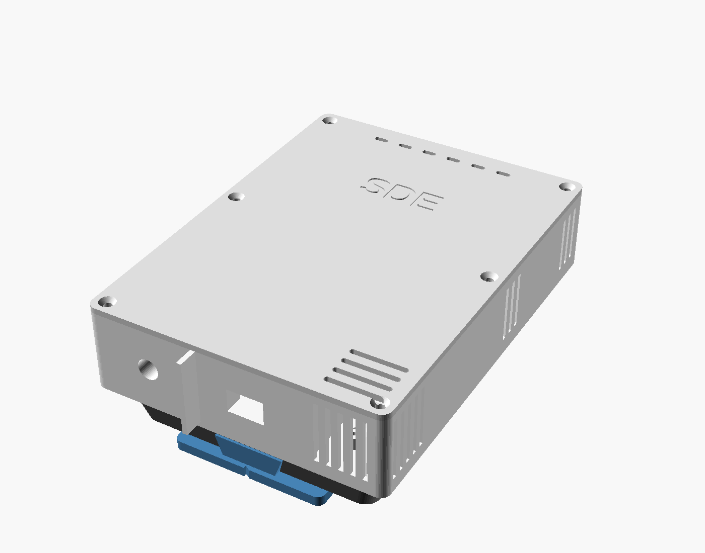
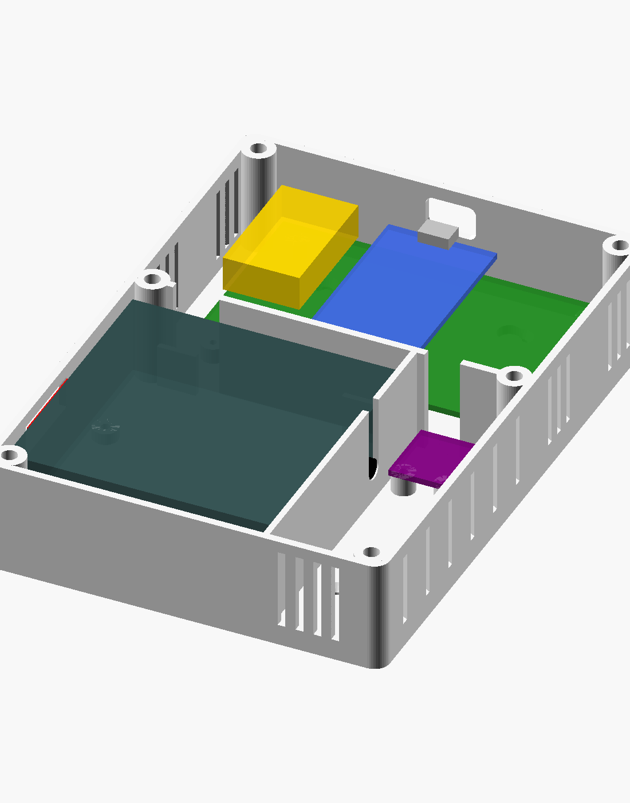

<div align="center">

# SDE · Station de Diagnostic Environnemental

**Station connectée de mesure de la qualité de l'air intérieur : ESP32, trois capteurs, application web et Android, accès à distance par MQTT/TLS, boîtier imprimé en 3D.**

[](https://github.com/isadrak/SDE-Station/actions/workflows/firmware.yml)


**[▶ Essayer la démo en ligne](https://isadrak.github.io/SDE-Station/)** (clique sur « Voir une démonstration »)



</div>

---

## Le projet

SDE mesure en continu le **CO2**, les **particules fines (PM2.5 / PM10)**, la **température**, l'**humidité**, la **pression** et les **composés organiques volatils** d'une pièce, puis transforme ces mesures en une **note de 1 à 5** fondée uniquement sur des normes publiées (EN 16798-1, AQI de l'EPA, OMS, Santé Canada) et en **conseils concrets** (« aère 10 minutes », « la chambre se confine la nuit »…).

Je l'ai conçu de bout en bout, du matériel à l'application :

- **Électronique** : carte porteuse (carrier board) dessinée sous KiCad pour un ESP32-DevKitC-32E, fabriquée, soudée et mise au point.
- **Firmware** embarqué en C++ (FreeRTOS, deux cœurs, watchdog, historique de 30 jours en flash, mises à jour OTA, journal qui survit aux plantages).
- **Application** web progressive servie par la station elle-même, plus une appli Android native.
- **Accès à distance** chiffré par MQTT sur TLS (EMQX Cloud), pour consulter la station depuis n'importe où.
- **Boîtier mural** paramétrique sous OpenSCAD, avec un socle lumineux qui prend la couleur de la qualité de l'air.

| Accueil sur téléphone | Mesures (thème sombre) | Vue ingénieur |
|:---:|:---:|:---:|
|  |  |  |

## Fonctionnalités

**Mesure et analyse**
- Trois capteurs : MH-Z19B (CO2, NDIR), SDS011 (particules, laser), BME680 (T, HR, pression, COV).
- Note globale = la plus basse des notes par mesure (règle de l'AQI), sans pondération maison. Particules notées par le **NowCast** de l'EPA.
- Conseils calculés sur 24 h minute par minute et 7 jours : détection automatique des aérations (renouvellements d'air par heure), confinement nocturne, air sec, pics de cuisson, point de rosée, chute de pression…
- Courbes 1 h / 24 h / 7 j / 30 j colorées en dégradé selon la zone de la norme, lissage médian + gaussien adapté à chaque capteur.

**Firmware**
- Deux tâches sur deux cœurs (capteurs sur le cœur 1, réseau sur le cœur 0) reliées par une file FreeRTOS, toutes surveillées par le watchdog.
- SDS011 en cycle (réveil, ventilation 30 s, mesure 10 s, sommeil) pour préserver son laser : ~13 % de temps actif.
- Historique d'une moyenne par minute sur **30 jours** en LittleFS (fichiers en ajout seul, au plus 5 min perdues sur coupure).
- Point d'accès Wi-Fi toujours actif + Wi-Fi de la maison, portail captif, mDNS `sde.local`, API HTTP REST.
- **Mise à jour OTA** depuis l'appli, protégée par mot de passe, avec retour à l'ancienne version si l'envoi échoue.
- **Journal de diagnostic** en RAM RTC (survit aux plantages) puis en flash, avec la pile d'appels relue dans la partition coredump.
- Client **MQTT/TLS** (esp-mqtt) avec testament, messages retenus, historique envoyé par morceaux sous les limites du broker, garde-fous mémoire.

**Applications**
- Application web progressive (un seul fichier HTML, Chart.js) installable, hors ligne, thèmes clair/sombre, visite guidée, assistant de configuration du Wi-Fi.
- Connexion par Wi-Fi, par **câble USB (Web Serial)**, par l'Internet (MQTT sur WebSocket) ou par import CSV ; **mode démonstration** sans matériel.
- **Vue ingénieur** : sous-indices, statistiques (min, moyenne, P95, max), diagnostics des capteurs, mémoire, réseau, journal de la station.
- Appli **Android** (Java, sans AndroidX) : WebView plein écran qui se met à jour toute seule avec la station, liaison forcée au Wi-Fi sans Internet, exports via le sélecteur de fichiers.

## Architecture



Sujets MQTT sous `sde/<SDE-XXXX>/` : `status` (testament online/offline), `info` et `live` (messages retenus), `req` (demandes de l'appli) et `res/<client>` (réponses, historique par morceaux). Les commandes sensibles (Wi-Fi, mise à jour, effacement) restent réservées au réseau local.

## Matériel

| Élément | Rôle | Liaison (ESP32) |
|---|---|---|
| ESP32-DevKitC-32E | Microcontrôleur double cœur, Wi-Fi | — |
| MH-Z19B | CO2 par infrarouge non dispersif, 0–5000 ppm | UART : IO16 (RX), IO17 (TX) |
| SDS011 | Particules PM2.5 et PM10, diffusion laser | UART : IO26 (RX), IO27 (TX) |
| BME680 | Température, humidité, pression, gaz (COV) | I2C : IO21 (SDA), IO22 (SCL) |
| Bande WS2812B (prévue en V2) | Lumière murale couleur de la note | IO18 via 330 Ω |
| Carrier board maison (KiCad) | Connecteurs, découplage 220 µF / 100 nF, alim 5 V USB | — |

### La carte électronique

Carte porteuse deux couches dessinée sous KiCad : l'ESP32-DevKitC-32E sur connecteurs femelles, le MH-Z19B soudé sur la carte, des connecteurs JST pour le BME680 et le SDS011, un condensateur de 220 µF sur le 5 V et un découplage de 100 nF sur le 3,3 V.

<p align="center">
  
</p>

| Schéma | Routage |
|:---:|:---:|
|  |  |

Leçons de la V1, à corriger en V2 : le GND du MH-Z19B n'était pas routé (fil volant ajouté sur la carte fabriquée), et R1/R2 se sont retrouvées en série sur SDA/SCL au lieu d'être des résistances de tirage (pontées, le module BME680 a déjà les siennes).

Le boîtier mural (dossier [`boitier/`](boitier/)) sépare l'électronique en haut et le flux d'air du SDS011 en bas, isole le BME680 de la chaleur de l'ESP32 et se glisse sur un rail en queue d'aronde fixé au mur.

<p align="center">
  
  
</p>

## Organisation du dépôt

```
firmware/   Firmware ESP32 (C++, arduino-esp32 / ESP-IDF, build.sh)
  src/hal/    Pilotes : MH-Z19B, SDS011, BME680, bande LED (RMT)
  src/app/    Logique : moyenne mobile, cycle du SDS011, couleur de la note
  src/net/    Wi-Fi, serveur HTTP, historique LittleFS, MQTT/TLS, journal, heure
  tools/      Intégration de l'appli dans le firmware (gzip -> assets.h)
app/        Application web (PWA) servie par la station et par GitHub Pages
android/    Appli Android (WebView native, build sans Android Studio)
boitier/    Boîtier OpenSCAD paramétrique, STL et aperçus
docs/       Guide d'utilisation complet et captures
```

## Démarrer

### Flasher une station (sans rien installer)

1. Télécharge `sde-firmware-X.Y.Z-merged.bin` dans les [Releases](../../releases).
2. Ouvre [ESP Tool](https://espressif.github.io/esptool-js/) dans Chrome ou Edge, connecte l'ESP32 en USB, adresse `0x0`, **Program**.
3. Connecte-toi au Wi-Fi **SDE-XXXX** (mot de passe par défaut `sde-station`, à changer) puis ouvre `http://192.168.4.1`.

Les mises à jour suivantes se font par Wi-Fi depuis l'appli, avec le fichier `-ota.bin`. Tout le reste (Wi-Fi de la maison, appli Android, accès à distance, calibration) est décrit dans le [guide d'utilisation](docs/guide-utilisation.md).

### Compiler le firmware

Prérequis : [arduino-cli](https://arduino.github.io/arduino-cli/), Node.js et esptool (`pip install esptool`).

```bash
firmware/build.sh --setup   # 1re fois : installe le cœur ESP32 2.0.17 et les bibliothèques
firmware/build.sh           # compile et produit firmware/dist/*-ota.bin et *-merged.bin
```

Le script intègre d'abord l'application (`app/`) dans le firmware sous forme compressée. La version est dans `firmware/VERSION`. GitHub Actions compile à chaque push, et chaque tag `v*` (ou commit marqué `[release]`) publie les binaires dans une Release.

### Essayer l'application sans matériel

Ouvre la [démo en ligne](https://isadrak.github.io/SDE-Station/) (ou `app/sde-analyse.html` en local) et clique sur **Voir une démonstration** : toute l'interface tourne avec des données simulées.

## Démarche et difficultés résolues

Quelques problèmes réels rencontrés et la façon dont ils ont été diagnostiqués :

- **Bus I2C bloqué à 0 V** : diagnostic par étapes (scan I2C intégré au firmware, contrôle des niveaux de SDA/SCL avant `Wire.begin`, tests avec et sans module) jusqu'à un contact cassé sur la broche 3V3 du connecteur de l'ESP32. Ajout d'une détection de défaut pour que le reste de la station continue de tourner.
- **Station figée pendant l'envoi de l'historique à distance** : la pile d'appels relue dans la partition coredump a montré que la bibliothèque NeoPixel installait et retirait le pilote RMT 33 fois par seconde ; sous pression mémoire, l'allocation finissait par échouer. Pilote RMT installé une seule fois, image envoyée seulement quand la couleur change.
- **TLS avec ~50 ko de tas libre** : chaîne de certificats réduite au strict nécessaire, tampons d'historique fixes au lieu de `String`, points en direct compactés de 80 à 44 octets : environ 30 ko de tas permanents récupérés.
- **Flash presque pleine (99 %)** : l'appli est minifiée et compressée en gzip avant d'être embarquée.

## Pistes pour la suite

- PCB V2 : routage du GND du MH-Z19B, résistances de tirage I2C corrigées, sortie pour la bande LED (74AHCT1G125, 1000 µF).
- Table de partitions plus grande pour faire de la place au programme.
- Tableau de bord InfluxDB + Grafana abonné aux mêmes sujets MQTT.

---

<details>
<summary><b>English summary</b></summary>

**SDE (Environmental Diagnostic Station)** is an end-to-end indoor air-quality monitor I designed and built: a custom KiCad carrier board for an ESP32 with three sensors (MH-Z19B CO2, SDS011 particulate matter, BME680 temperature/humidity/pressure/VOC), C++ firmware on FreeRTOS (dual-core task split, watchdog, 30-day flash history on LittleFS, password-protected OTA updates, crash-surviving event log with coredump backtraces), and an MQTT-over-TLS link to EMQX Cloud for remote access.

The station serves its own installable progressive web app (single HTML file, Chart.js) that turns raw readings into a 1–5 score based strictly on published standards (EN 16798-1, US EPA AQI with NowCast, WHO, Health Canada) and into actionable advice (automatic airing detection with air-changes-per-hour, night-time stuffiness, humidity and dew point, cooking peaks). The same app connects over Wi-Fi, USB (Web Serial), MQTT over WebSocket, or CSV import, and includes a demo mode and an "engineer view". A lightweight native Android shell (Java, no AndroidX) and a parametric OpenSCAD wall enclosure with an LED status strip complete the project.

</details>

## Licence

Code et modèles 3D sous licence [MIT](LICENSE).
