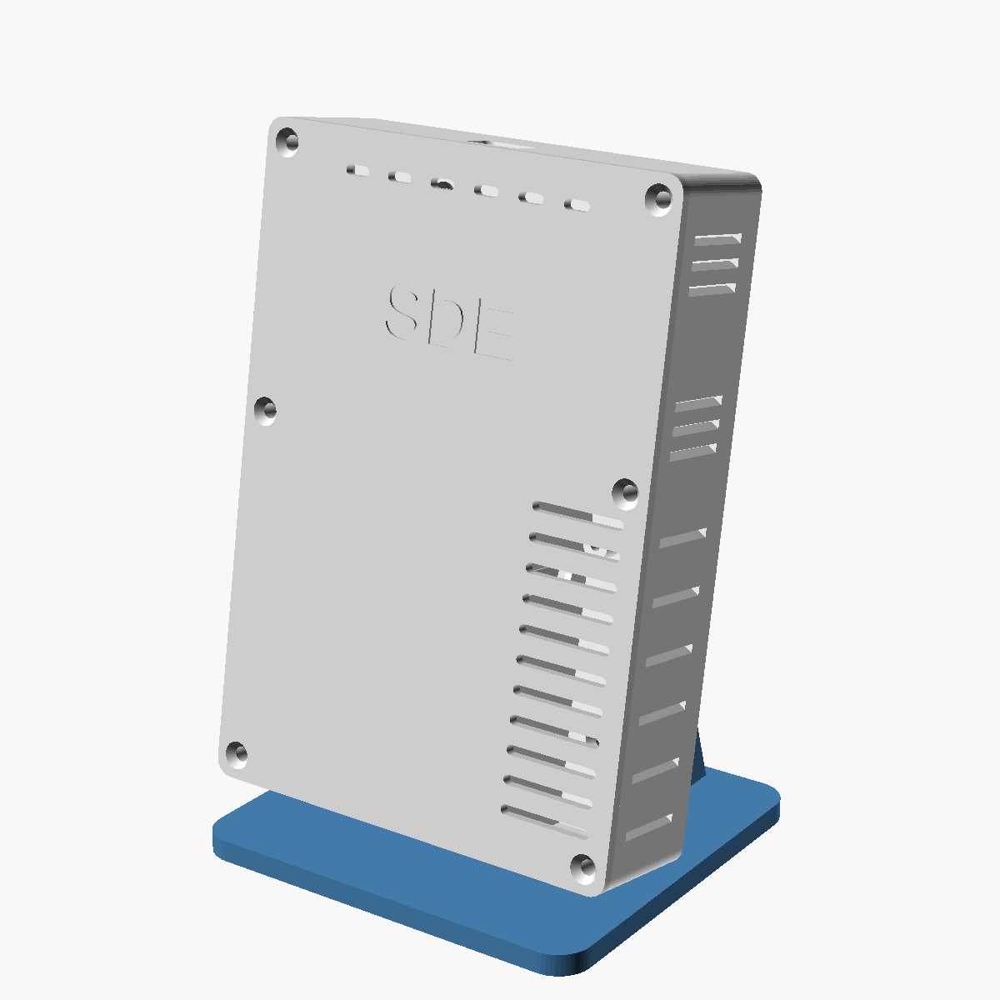
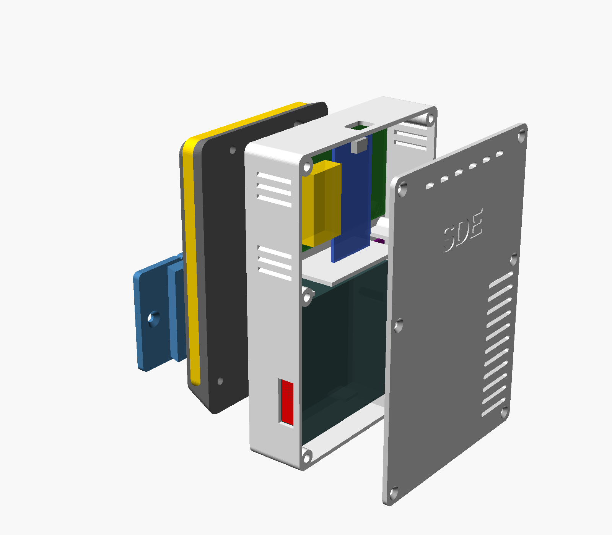
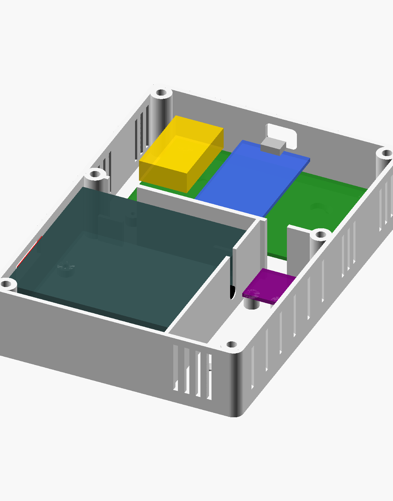
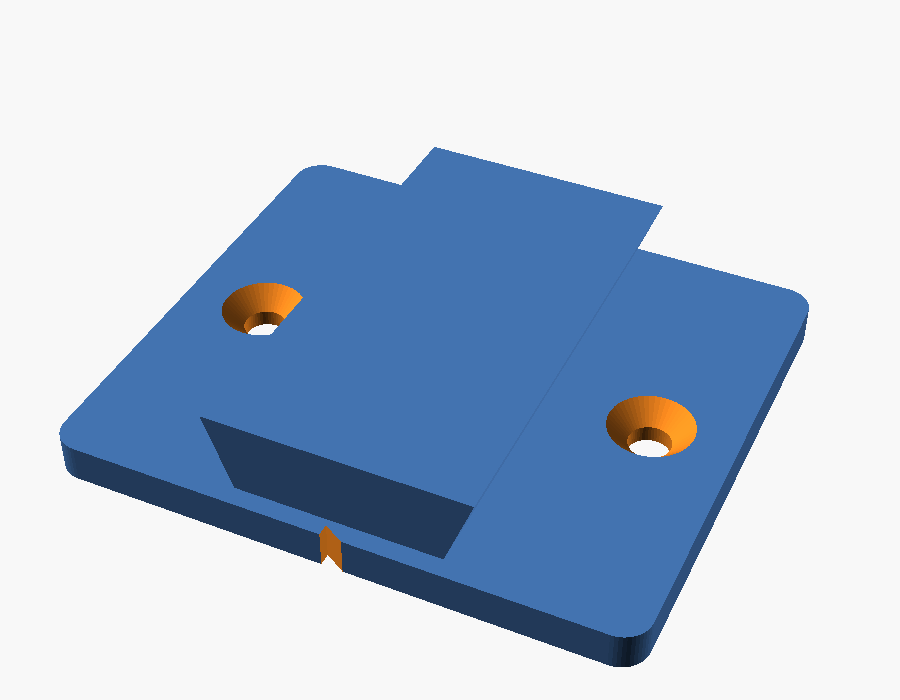
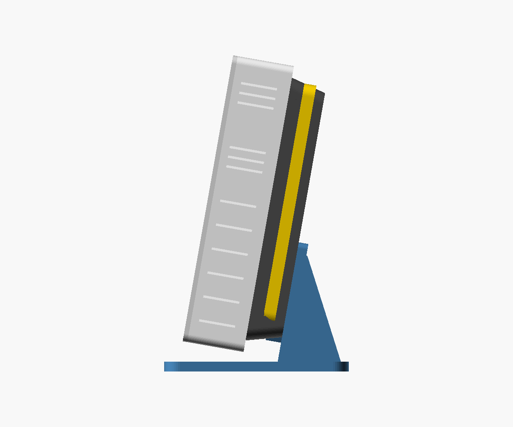
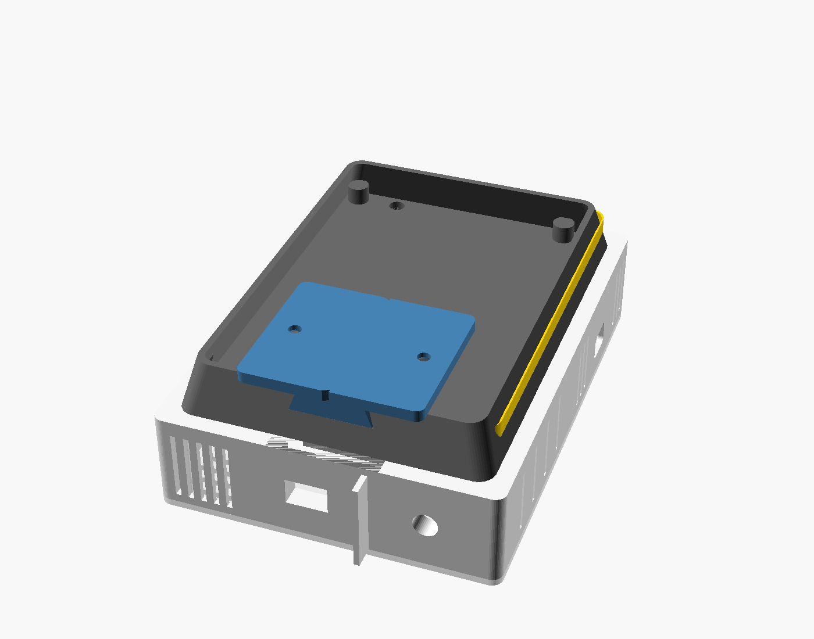

# Boîtier SDE

Boîtier imprimable en 3D pour la station, modélisé sous OpenSCAD. Il se fixe au mur sur une glissière, ou se pose sur un pied de table.

## Fichiers

| Fichier | Contenu |
|---|---|
| `sde-boitier.scad` | Modèle paramétrique, toutes les cotes en haut du fichier |
| `stl/sde-corps.stl` | Corps, ouvert à l'avant (s'imprime dos sur le plateau) |
| `stl/sde-capot.stl` | Façade avant, déjà retournée |
| `stl/sde-socle.stl` | Pièce vissée au dos : bande LED et rainure de la glissière |
| `stl/sde-support.stl` | Plaque murale avec son rail |
| `stl/sde-pied.stl` | Pied de table, même rail |
| `apercu/` | Rendus (avant, arrière, intérieur, éclatée, support, pied) |

Encombrement : 104 × 148 mm de face, 31,5 mm d'épaisseur avec le capot, 53,5 mm du mur à la façade avec le socle et la plaque.

## Cotes

- Carte : export STEP de KiCad. Au mur, elle est tournée de 180° (micro-USB en haut, MH-Z19B à gauche). Trous Ø 2,2 (M2) à (79,65 ; 50,05), (5 ; 50), (79,75 ; 3,5) et (5 ; 3,6) depuis le coin bas-gauche. Le DevKitC dépasse de 5,9 mm du bas de la carte.
- Mesuré au pied à coulisse : USB à 13 mm au-dessus de la carte et 3,8 mm en retrait du bord, point le plus haut à 19,5 mm. SDS011 69,5 × 69,5 × 20 mm, buse Ø 5 sur la face droite, sortie 22 × 8 mm sur la face gauche. BME680 16 × 18 mm, 2 trous Ø 3 à 11 mm d'entraxe.
- La fiche du SDS011 annonce 71 × 70 × 23 mm (buse et relief compris). Le boîtier laisse 23,6 mm au-dessus des plots, donc les deux valeurs passent. L'encoche de la buse fait 5,4 mm.

## Organisation interne

- **En haut, l'électronique.** Carte vissée sur 4 plots de 4 mm. La fiche micro-USB passe par un trou de 13 × 9 mm dans la paroi du haut (câble à embout fin, moins de 11 × 7 mm). Des fentes sur les côtés et dans le capot évacuent la chaleur de l'ESP32.
- **En bas à gauche, le SDS011**, sur 2 plots contre la paroi gauche. Sa sortie de ventilateur tombe en face d'une ouverture de 22 × 8 mm : l'air mesuré ressort à gauche.
- **En bas à droite, une chambre d'air frais**, séparée du SDS011 par un mur. L'air entre par des fentes à droite, en bas et dans le capot. La buse du SDS011 traverse le mur par une encoche en U, refermée par une languette du capot. Le capteur aspire à droite et rejette à gauche, sans réaspirer son propre rejet.
- **Le BME680** est en haut de cette chambre, dans le flux qui va vers la buse, isolé de l'ESP32 par la cloison. Avec un fil plus long (~15 cm), `bme_bas = true` le place en bas de la chambre, à 7 cm de l'ESP32 au lieu de 2.
- La cloison a deux fentes pour les câbles du SDS011 et du BME680, à boucher avec de la mousse pour que la chaleur ne descende pas.

## Fixation murale

La plaque (62 × 54 mm) se visse au mur avec 2 vis de 4 mm. Elle porte un rail vertical en queue d'aronde de 50 mm ; le socle a la rainure correspondante, ouverte vers le bas. On descend le boîtier sur le rail, on le remonte de 5 cm pour l'enlever. Le rail et la rainure se resserrent de 0,8 mm vers le haut, pour que le serrage n'arrive qu'en fin de course (réglable avec `jeu` et `rail_conicite`).

La station pèse environ 200 g : chevilles à placo ou Molly sur du placoplâtre, chevilles nylon de 6 mm sur béton ou brique.

## Pied de table

Le pied porte le même rail que la plaque murale, donc le boîtier passe de l'un à l'autre sans rien démonter. Base de 100 × 94 mm, plaque inclinée de 10° vers l'arrière, bas du boîtier à 5 mm de la table pour ne pas boucher les fentes d'entrée d'air. Inclinaison et hauteur réglables (`pied_incl`, `pied_leve`).

## Bande LED

Le socle tient le boîtier à 22 mm du mur. Ses flancs sont inclinés de 15° et le boîtier les dépasse de 6 mm : la bande est invisible de face et n'éclaire que le mur autour, dans la couleur de la note.

- Bande WS2812B 5 V, 60 LED/m, IP30 : 22 LED (~37 cm) collées en U sur le socle.
- Câblage : 5 V et GND de la carte, DIN sur IO18 à travers 330 Ω. Sur la carte V1, IO18 n'est pas routé : fil soudé sous le connecteur de l'ESP32, qui passe par le trou de 6 mm du dos.
- Alimentation par l'USB de l'ESP32, courant plafonné à 600 mA par le firmware, chargeur 5 V 2 A conseillé.
- L'ESP32 sort du 3,3 V alors que la bande attend 3,5 V minimum. Ça passe en général sur un fil court ; la V2 du PCB ajoutera un 74AHCT1G125.

Côté firmware, chaque mesure est placée sur une échelle continue de 0 (vert) à 4 (rouge) avec les mêmes normes que l'appli, et la plus mauvaise l'emporte. La teinte change en fondu sur ~8 s, respire en blanc pendant le préchauffage et pulse au-delà de la note 2. Luminosité réglable avec la commande `led <0-100>`. Code : `firmware/src/app/air_color.h` et `firmware/src/hal/led_strip.cpp`, réglages dans `config.h`.

## Impression et montage

PETG ou ABS, buse 0,4, couches de 0,2 mm, 4 périmètres, 20 % de remplissage, aucun support. Toutes les pièces ont été découpées dans PrusaSlicer avant impression :

| Pièce | Temps (profil générique) | PETG |
|---|---|---|
| Corps | 9 h | 82 g |
| Capot | 3 h 20 | 32 g |
| Socle | 4 h 40 | 57 g |
| Support mural | 1 h 10 | 14 g |
| Pied de table | 4 h 15 | 56 g |

Visserie :
- capot et socle : 10 vis M3 × 8 à tête fraisée, directement dans le plastique (trous de 2,5 mm) ; `inserts = true` passe à des inserts laiton ;
- carte : 4 vis M2 × 6 autotaraudeuses ;
- SDS011 : 2 vis M2,5 × 10, BME680 : 2 vis M2,5 × 6 ;
- mur : 2 vis 4 × 30 et chevilles ; table : 4 patins adhésifs.

Ordre de montage : bande sur le socle, socle sur le corps, SDS011 (buse dans l'encoche), BME680, carte, câbles dans la cloison puis mousse, antenne collée contre la paroi droite, capot.

Pour modifier une cote : ouvrir `sde-boitier.scad` dans OpenSCAD, choisir la pièce avec `piece` (`interieur` et `sur_table` affichent l'ensemble monté), F6, puis export STL.
