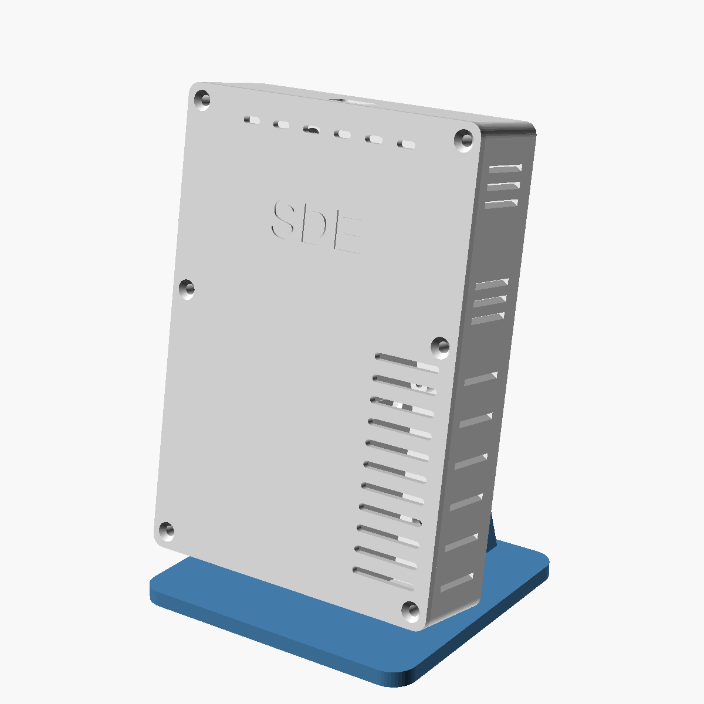
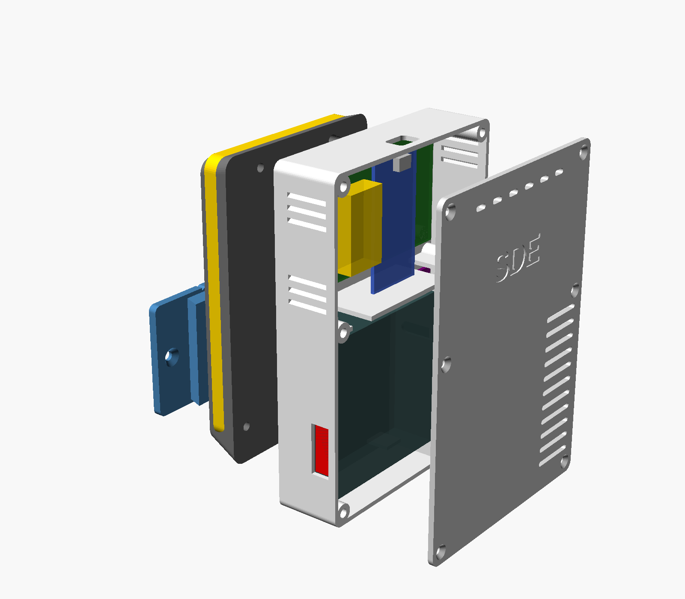
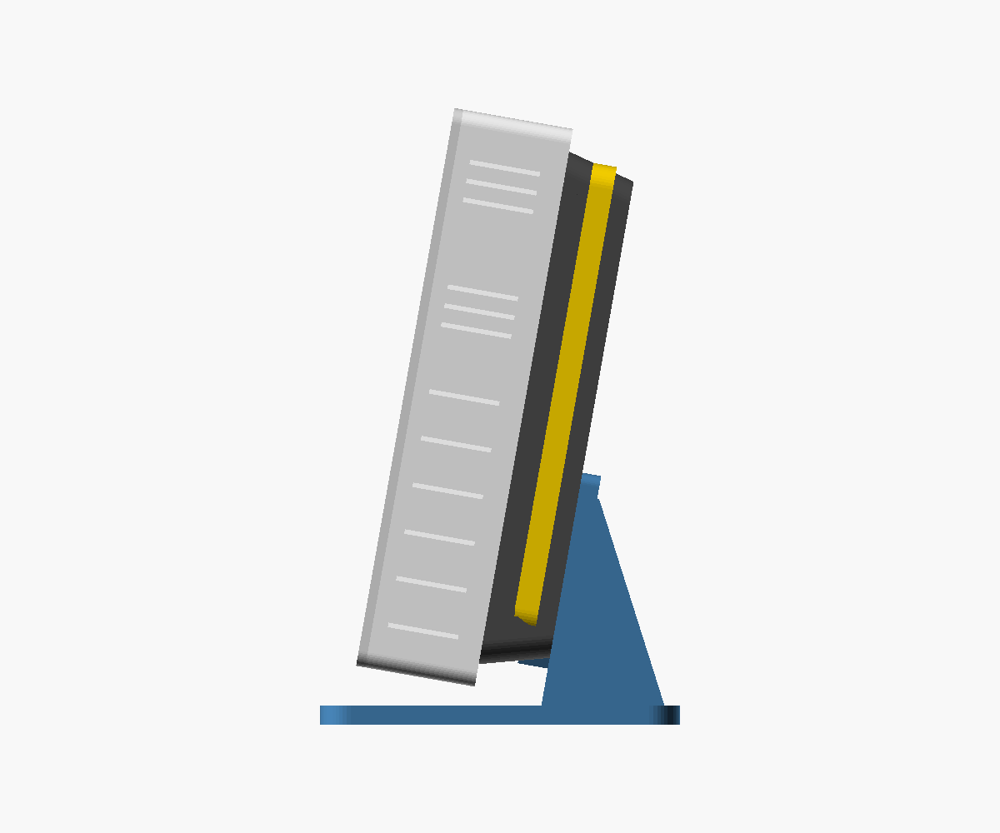

# SDE : boîtier, socle lumineux, support mural et pied de table

## Ce qu'il y a dans ce dossier

| Fichier | Rôle |
|---|---|
| `sde-boitier.scad` | Le modèle OpenSCAD paramétrique. Toutes les cotes sont en haut du fichier. |
| `stl/sde-corps.stl` | Le boîtier, ouvert à l'avant. S'imprime dos sur le plateau. |
| `stl/sde-capot.stl` | La façade avant, déjà retournée (face « SDE » sur le plateau). |
| `stl/sde-socle.stl` | La pièce vissée au dos : elle porte la bande LED et la rainure de la glissière. |
| `stl/sde-support.stl` | La plaque vissée au mur, avec son rail. |
| `stl/sde-pied.stl` | Le pied pour poser la station sur une table, avec le même rail. |
| `apercu/` | Vues de contrôle (avant, arrière, intérieur avec les pièces en place, support, pied). |

Encombrement : 104 × 148 mm de face, 31,5 mm d'épaisseur pour le boîtier avec son capot, 53,5 mm du mur à la façade avec le socle et la plaque.

## 1. D'où viennent les cotes

- **La carte** vient de l'export STEP de KiCad. Au mur elle est tournée de 180° par rapport au STEP : micro-USB en haut, MH-Z19B à gauche. Trous Ø 2,2 (vis M2) à (79,65 ; 50,05), (5 ; 50), (79,75 ; 3,5) et (5 ; 3,6) depuis le coin bas-gauche. Le DevKitC dépasse de 5,9 mm du bord bas de la carte (côté antenne) : le compartiment en tient compte.
- **Tes mesures du 2026-10-25** : USB à 13 mm au-dessus de la carte et 3,8 mm en retrait du bord, point le plus haut à 19,5 mm, broches à 2 mm sous la carte ; SDS011 69,5 × 69,5 × 20 mm, buse Ø 5 sur la face droite (20 mm du haut, 5,5 mm de la base), sortie 22 × 8 mm sur la face gauche, 2 trous Ø 3 ; BME680 16 × 18 mm, 2 trous Ø 3 à 11 mm d'entraxe, centrés à 6 mm du bord côté puce (opposé au fil), fil de 52 mm.
- **La fiche technique du SDS011** donne 71 × 70 × 23 mm, buse comprise. C'est cohérent avec tes 69,5 mm de plaque plus les 1,5 mm de buse qui dépassent. Les 23 mm d'épaisseur doivent compter un relief (ventilateur ou connecteur) : le boîtier a de la place jusqu'à 23,6 mm au-dessus des plots, donc les deux valeurs passent. La fiche donne aussi un tuyau de 6 mm intérieur pour la buse, ce qui va avec ton Ø 5 extérieur à quelques dixièmes près : l'encoche fait 5,4 mm.

## 2. Comment le boîtier est organisé

- **En haut, le compartiment électronique.** La carte est vissée sur 4 plots de 4 mm (vis M2 autotaraudeuses) contre le dos, son bord haut à 0,5 mm de la paroi. La fiche micro-USB passe par un trou de 13 × 9 mm dans la paroi du haut : comme le connecteur est 3,8 mm en retrait, la fiche s'enfonce d'environ 6 mm dans le trou. Un câble au bout moulé fin (moins de 11 × 7 mm) entre sans forcer. Des fentes sur les deux côtés et en haut du capot laissent sortir l'air chaud de l'ESP32.
- **En bas à gauche, le SDS011.** Il est posé à plat sur 2 plots (vis M2,5) contre la paroi gauche. Sa sortie de ventilateur tombe en face d'un trou exact de 22 × 8 mm (plus 0,25 mm de jeu) dans cette paroi : l'air mesuré ressort à gauche du boîtier.
- **En bas à droite, la chambre d'air frais.** Elle est séparée du SDS011 par un mur. L'air de la pièce y entre par des fentes à droite, en bas et dans le capot. La buse du SDS011 se pose dans une encoche en U de ce mur, et une languette du capot vient fermer l'encoche par-dessus quand on visse le capot. Le capteur aspire donc l'air frais à droite et le rejette à gauche, sans réaspirer son propre rejet.
- **Le BME680** est dans le haut de cette chambre, dans le courant d'air qui va vers la buse. Il est vissé sur 2 plots de 5 mm (vis M2,5), fil vers le haut. Son fil passe par une fente de la cloison juste au-dessus : il faut environ 3 cm de fil, donc tes 52 mm suffisent. Pas besoin de le ressouder.
- **La cloison** a deux fentes sur toute la profondeur : à gauche pour le câble du SDS011, à droite pour celui du BME680. Bouche-les avec un bout de mousse une fois les câbles passés, pour que la chaleur de l'électronique ne descende pas.

**Si tu ressoudes le BME680 avec un fil plus long (environ 15 cm)**, mets `bme_bas = true` : le module descend en bas de la chambre, à environ 7 cm de l'ESP32 au lieu de 2. Il sera moins réchauffé par l'électronique (la cloison tiédit un peu), et toujours dans l'air frais qui entre par le bas. Ce n'est pas obligatoire : en haut de la chambre il est déjà séparé de l'ESP32 par la cloison, et décalé sur le côté.

**L'antenne de l'ESP32-32U** (fil de 40 mm) : colle-la à plat contre la paroi droite du compartiment électronique, à l'intérieur, loin du cuivre de la carte. Il y a la place entre la carte et la paroi.

## 3. La fixation murale (on glisse vers le bas, on retire vers le haut)

- La **plaque** (62 × 54 mm) se visse au mur avec 2 vis de 4 mm à tête fraisée. Deux encoches en V, en haut et en bas, servent de repères pour la mettre d'aplomb.
- Elle porte un **rail en queue d'aronde** vertical de 50 mm. Le **socle** au dos du boîtier a la rainure correspondante, ouverte vers le bas.
- On présente le boîtier au-dessus du rail et on le descend : la queue d'aronde l'empêche de se décoller du mur. Il s'arrête quand le haut du rail touche le fond de la rainure.
- Le rail et la rainure rétrécissent de 0,8 mm vers le haut. L'entrée est donc libre, et le serrage n'arrive qu'en fin de course. Si c'est trop serré ou trop lâche, change `jeu` (0,25 mm) ou `rail_conicite`.
- Pour l'enlever, on le remonte de 5 cm.

**Quel mur ?** La station pèse environ 200 g, donc presque tous les murs conviennent. Tape le mur du doigt :
- **ça sonne creux** : c'est du gypse (placoplâtre). Prends 2 chevilles à gypse en plastique ou des chevilles métalliques à expansion (type Molly) pour vis de 4 mm. Si tu tombes sur un montant en bois (ça sonne plein à cet endroit), visse directement dedans avec des vis à bois 4 × 30 ;
- **ça sonne plein et c'est dur** : béton ou brique. Perce au foret à béton de 6 mm et mets des chevilles en nylon de 6 mm avec des vis 4 × 30 ;
- dans le doute, des chevilles universelles de 6 mm tiennent dans les deux cas.

## 3 bis. Le pied de table

Le **pied** porte exactement le même rail que la plaque murale : on y glisse le boîtier de la même façon, et on passe du mur à la table sans rien démonter.

- Base de 100 × 94 mm, plaque inclinée de 10° vers l'arrière pour que la façade regarde un peu vers le haut, et deux équerres derrière. Le centre de gravité tombe bien à l'intérieur de la base.
- Le bas du boîtier reste à environ 5 mm au-dessus de la base, pour ne pas boucher les fentes du bas de la chambre d'air frais.
- Colle 4 patins en feutre ou en caoutchouc sous la base pour qu'elle ne glisse pas quand tu branches l'USB.
- Sur une table, la bande LED éclaire le pied et le mur derrière s'il est proche. L'effet de halo est plus discret qu'au mur.
- Il s'imprime base sur le plateau, sans supports. L'inclinaison (`pied_incl`) et la hauteur (`pied_leve`) se règlent en haut du fichier.

## 4. La bande LED (halo sur le mur)

Le socle tient le boîtier à 22 mm du mur (18 mm de socle et 4 mm de plaque). Ses flancs sont inclinés de 15° vers le mur et le boîtier les dépasse de 6 mm : la bande est cachée de face, et sa lumière n'éclaire que le mur autour du boîtier.

**Quoi acheter :** une bande **WS2812B 5 V, 60 LED/m, 10 mm de large, IP30** (sans gaine silicone, elle se colle mieux et chauffe moins). Il en faut **22 LED, soit environ 37 cm**, collées en U sur le socle : côté droit, haut, côté gauche. Le bas reste libre à cause de la rainure de la glissière. Une SK6812 fonctionne aussi ; une bande « COB » adressable donne une lumière continue sans points, mais vérifie qu'elle est bien en 5 V.

**Câblage :**

| Bande | Carte |
|---|---|
| 5 V | 5 V de la carte (EXT_5V) |
| GND | GND |
| DIN | IO18, à travers une résistance de 330 Ω placée près de la carte |

- Un condensateur de 1000 µF 6,3 V entre 5 V et GND au début de la bande protège les LED à la mise sous tension.
- La bande attend un signal de 3,5 V minimum, l'ESP32 envoie 3,3 V. Sur 20 cm de fil, ça marche souvent. Si la bande scintille ou affiche n'importe quoi, il faut un adaptateur de niveau (voir la V2 ci-dessous).
- Le fil passe du compartiment électronique au socle par le trou de 6 mm du dos, puis sort du socle par l'encoche du côté droit, en bas, là où commence la bande.
- **Sur la carte V1**, IO18 n'est relié à rien : soude un fil sous le connecteur femelle de l'ESP32, sur la broche IO18.

**Alimentation :** tout passe par le câble USB de l'ESP32. Le firmware plafonne la bande à 600 mA. Avec l'ESP32 en Wi-Fi, le ventilateur du SDS011 et le MH-Z19B, prévois un chargeur 5 V de 2 A. Ce courant traverse le connecteur USB et les pistes de l'ESP32 : si tu veux plus de lumière, ajoute en V2 une entrée 5 V dédiée (USB-C) pour la bande.

**À ajouter sur le PCB V2** (avec le GND du MH-Z19B à router et les R1/R2 à retirer) :
- un connecteur JST-XH 3 broches (5 V, DIN, GND) pour la bande ;
- un adaptateur de niveau 74AHCT1G125 (SOT-23-5, alimenté en 5 V) entre IO18 et DIN, puis la résistance de 330 Ω ;
- le condensateur de 1000 µF près du connecteur, plus un 100 nF.

## 5. La couleur selon la qualité de l'air (firmware 0.5.0)

Le firmware 0.5.0 (`firmware/bin/sde-firmware-0.5.0-*.bin`) contient déjà la gestion de la bande. Il compile, mais n'a pas encore été essayé avec une vraie bande. Sans bande branchée, il fonctionne comme la 0.4.3.

La couleur suit **les mêmes normes que la note de l'application** (AQI de l'EPA pour les particules, EN 16798-1 pour le CO2 et l'humidité, la plus mauvaise mesure l'emporte). Pour que le changement soit progressif, chaque mesure est placée sur une échelle continue de 0 à 4 au lieu de 5 notes entières, puis convertie en teinte :

| Position | Note de l'appli | Couleur |
|---|---|---|
| 0 | 5, excellente | vert |
| 1 | limite 5 / 4 | vert-jaune |
| 2 | limite 4 / 3 | jaune |
| 3 | limite 3 / 2 | orange |
| 4 | note 2 dépassée | rouge |

Exemples : 1000 ppm de CO2 donne un vert-jaune, 1500 ppm un jaune-orangé, 2500 ppm un orange-rouge, et 6000 ppm un rouge.

- Les particules sont moyennées sur environ 30 minutes, le CO2 avec la moyenne mobile du firmware, et rien n'est compté pendant le préchauffage du MH-Z19B. L'application, elle, utilise le NowCast sur 12 h pour les particules : la bande réagit donc un peu plus vite qu'elle.
- La couleur passe d'une teinte à l'autre en fondu (environ 8 s), sans saut.
- Tant qu'il n'y a pas de verdict (préchauffage, aucun capteur), la bande respire doucement en blanc.
- Au-delà de la note 2, la bande pulse lentement pour attirer l'attention.
- **Luminosité :** 40 % par défaut. La commande `led <0-100>` la change (0 = éteinte), et la valeur est gardée après un redémarrage. Tu peux l'envoyer sur l'USB ou par `POST /api/cmd`. L'état de la bande apparaît dans `GET /api/info`, champ `led`.

Les réglages sont dans `firmware/src/config.h` : `PIN_LED`, `LED_COUNT`, `LED_BRIGHTNESS_DEFAULT`, `LED_MAX_MA`, `LED_FADE_S`. La couleur est calculée dans `firmware/src/app/air_color.h`, et la bande est pilotée par `firmware/src/hal/led_strip.cpp`.

## 6. Impression et montage

**Impression :** PETG (ou ABS), buse 0,4, couches de 0,2 mm, 4 périmètres, 20 % de remplissage. Aucune pièce n'a besoin de supports : le corps s'imprime dos sur le plateau, le capot face avant sur le plateau (la languette de la buse pointe vers le haut, elle est fine : imprime-la doucement), le socle côté boîtier sur le plateau, la plaque à plat, le pied base sur le plateau.

**Visserie :**
- 10 inserts laiton M3 (trou de 4,0 mm, 5,7 mm de long) : 6 pour le capot, 4 dans le socle ;
- 6 vis M3 × 8 à tête fraisée (capot), 4 vis M3 × 8 à tête fraisée (socle, vissées de l'intérieur du corps) ;
- 4 vis M2 × 6 autotaraudeuses pour la carte (trous de 2,2 mm) ;
- 2 vis M2,5 × 10 autotaraudeuses pour le SDS011 et 2 vis M2,5 × 6 pour le BME680 (trous de 3 mm sur les modules, avant-trous de 2,2 mm dans les plots) ;
- pour le mur : 2 vis 4 × 30 à tête fraisée et 2 chevilles adaptées au mur (section 3) ;
- pour la table : 4 patins adhésifs.

**Ordre de montage :** poser les inserts au fer à souder, coller la bande sur le socle, visser le socle au corps (le fil de la bande passe par le trou du dos), visser le SDS011 (buse dans l'encoche), le BME680 et la carte, passer les câbles dans les fentes de la cloison et les boucher avec de la mousse, coller l'antenne, fermer le capot. Glisser le boîtier sur la plaque murale ou sur le pied.

**Modifier et réexporter :** ouvre `sde-boitier.scad` dans OpenSCAD (gratuit), change les valeurs en haut du fichier, choisis la pièce avec la variable `piece` (ou dans le panneau Customizer), puis **F6** et **Exporter en STL**. La valeur `interieur` affiche le boîtier avec les pièces en place, et `sur_table` le montre sur son pied.
