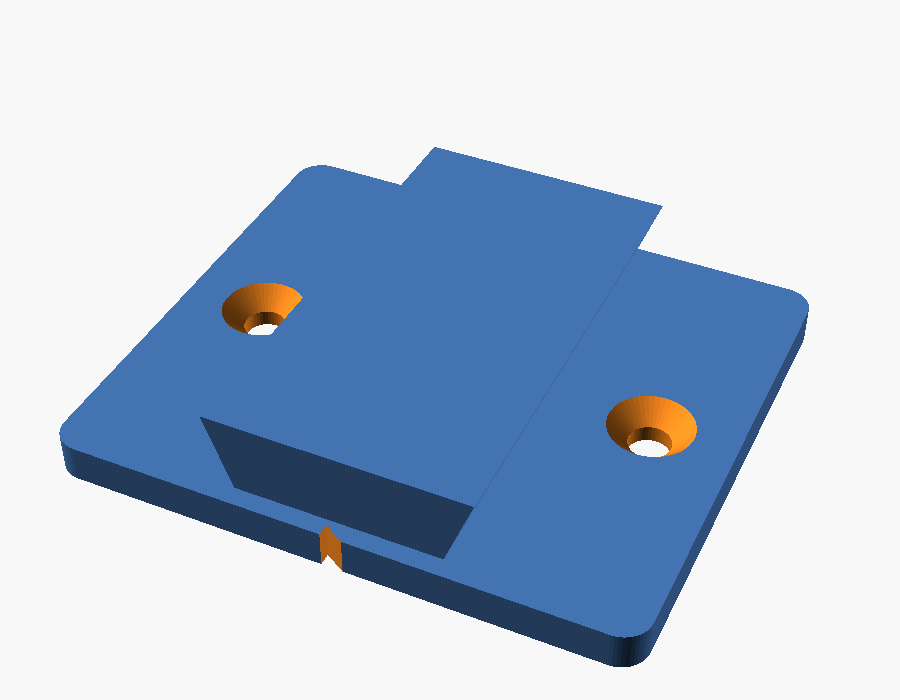
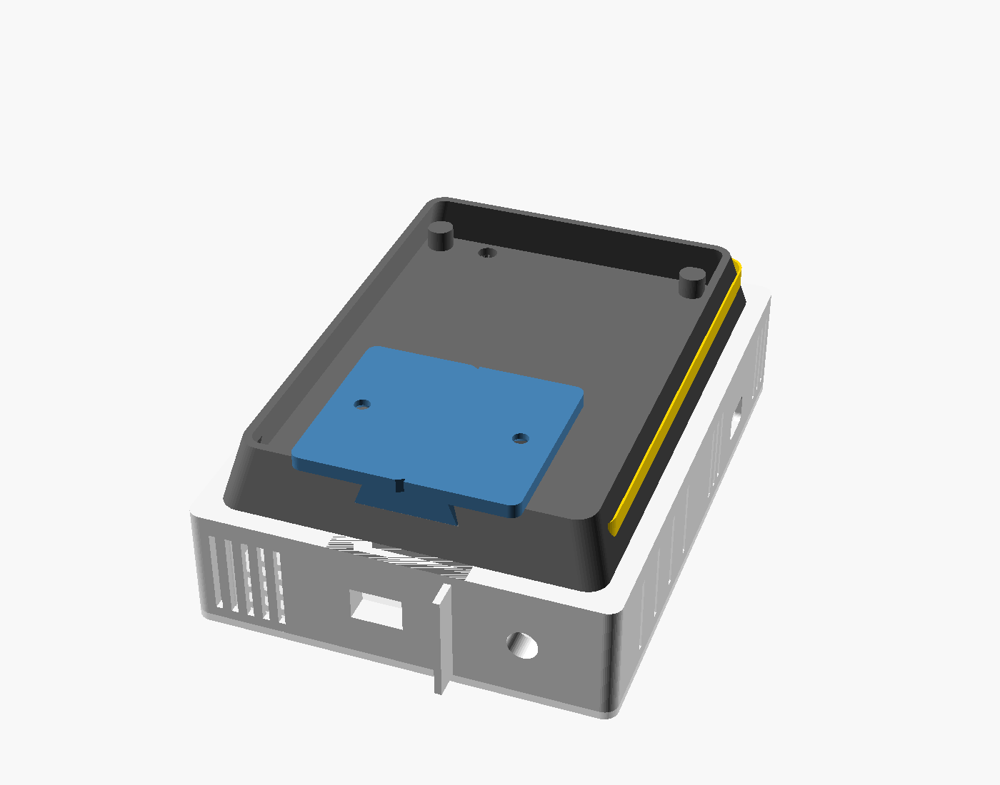

# SDE : boîtier mural, socle lumineux et support coulissant

## Ce qu'il y a dans ce dossier

| Fichier | Rôle |
|---|---|
| `sde-boitier.scad` | Le modèle OpenSCAD paramétrique. Toutes les cotes sont en haut du fichier. |
| `stl/sde-corps.stl` | Le boîtier, ouvert à l'avant. S'imprime dos sur le plateau. |
| `stl/sde-capot.stl` | La façade avant, déjà retournée (face « SDE » sur le plateau). |
| `stl/sde-socle.stl` | La pièce vissée au dos : elle porte la bande LED et la rainure de la glissière. |
| `stl/sde-support.stl` | La plaque vissée au mur, avec son rail. |
| `apercu/` | Vues de contrôle (avant, arrière, intérieur avec les pièces en place, support). |

**Les STL actuels sont faits avec des cotes provisoires.** Avant d'imprimer, mesure tes pièces (section 1), corrige les valeurs en haut de `sde-boitier.scad`, puis réexporte (section 6).

Encombrement avec les cotes provisoires : 118,5 × 161 mm de face, 35,5 mm d'épaisseur pour le boîtier, 57,5 mm du mur à la façade avec le socle et la plaque.

## 1. Les mesures à prendre

| Variable | Ce que c'est | Valeur provisoire |
|---|---|---|
| `pcb_l`, `pcb_h` | Largeur et hauteur de ta carte | 80 × 60 |
| `pcb_trou_dx`, `pcb_trou_dy` | Entraxe des 4 trous des coins | 72 × 52 |
| `pcb_composants` | Hauteur du plus haut composant au-dessus de la carte (ESP32 sur ses connecteurs femelles, MH-Z19B) | 22 |
| `usb_cote`, `usb_pos`, `usb_z` | Bord de la carte où sort l'USB de l'ESP32, position du connecteur le long de ce bord, hauteur de son centre au-dessus de la carte | gauche, 30, 11,5 |
| `usb_l`, `usb_h` | Taille du trou pour la fiche (mesure le bout moulé de ton câble, pas le connecteur) | 13 × 9 |
| `sds_entree_x`, `sds_entree_z`, `sds_entree_d` | Position et diamètre extérieur de la buse d'entrée du SDS011 | 12, 11,5, 8 |
| `sds_sortie_l`, `sds_sortie_h`, `sds_sortie_x`, `sds_sortie_z` | Taille et position de la sortie du ventilateur | 14 × 9, 52, 11,5 |
| `sds_trous` | Position des 2 trous de fixation du SDS011, depuis son coin bas-gauche | (5, 65) et (66, 5) |
| `sds_garde` | Distance entre la face des ouvertures du SDS011 et la paroi du bas (à régler pour que la buse entre dans son trou) | 6 |
| `bme_l`, `bme_h`, `bme_trou_dx` | Taille du module BME680 et entraxe de ses 2 trous | 15 × 14, 10 |

Seule la taille du SDS011 (71 × 70 × 23 mm) et le diamètre de sa buse (tuyau 6/8 mm) viennent de sa fiche technique. Le reste est à mesurer sur tes pièces. Les positions du SDS011 se mesurent la face des ouvertures vers toi, depuis le bord gauche (`_x`) et depuis la face posée contre le dos du boîtier (`_z`). Si la sortie du ventilateur n'est pas sur la même face que la buse, dis-le-moi et je déplace le conduit.

## 2. Comment le boîtier est organisé

Le principe « sandwich » de la page Notion est gardé, à la verticale :

- **En haut, le compartiment électronique.** La carte est vissée sur 4 plots (inserts M3) contre le dos, collée contre la paroi où sort l'USB : la fiche se branche par le trou de la paroi. Des fentes sur les deux côtés, en bas et en haut du compartiment, plus une rangée de fentes en haut du capot, laissent l'air chaud de l'ESP32 monter et sortir. Les fentes latérales sont inclinées vers le bas à l'extérieur, pour que la poussière n'entre pas.
- **En bas, le compartiment air.** Le SDS011 est posé à plat sur 2 plots, calé par 4 équerres. Sa buse d'entrée entre dans un collier qui traverse la paroi du bas, et sa sortie dans un conduit rectangulaire. Les deux trous font la taille exacte des ouvertures (plus 0,25 mm de jeu) et sont étanches vers l'intérieur : le capteur aspire l'air de la pièce et le rejette dehors, sans brasser l'air du boîtier. Un déflecteur de 8 mm sous le boîtier sépare les deux trous pour qu'il ne réaspire pas son propre rejet.
- **En bas à droite, la cellule du BME680.** C'est le point le plus éloigné de l'ESP32, et sous lui (la chaleur monte). Elle est fermée vers le SDS011 et ouverte sur la pièce par des fentes en bas, à droite et dans le capot. Le module se visse sur 2 plots (vis M2). Son fil JST passe par une encoche de la cellule, remonte le long de la paroi droite et traverse la cloison par le passage de câbles. Avec la carte collée à gauche, il faut environ 15 à 20 cm de fil selon l'endroit où il se branche : dis-moi la longueur du tien et je déplace la cellule ou la carte si besoin.
- **La cloison** a un passage de 14 × 6 mm à l'arrière pour les câbles des capteurs (à boucher avec un bout de mousse).

Écarts avec la page Notion, et pourquoi :
- La jupe autour du MH-Z19B n'est pas modélisée, parce que sa position sur la carte n'est pas connue. Il reste dans le compartiment électronique, aéré, ce qui suffit à un capteur NDIR (il compense sa température lui-même). La jupe peut revenir quand on connaît sa position.
- La trappe de service latérale est remplacée par le capot avant : 6 vis donnent accès à tout, et le boîtier est plus simple à imprimer.

## 3. La fixation murale (on glisse vers le bas, on retire vers le haut)

- La **plaque** (62 × 54 mm) se visse au mur avec 2 vis à bois de 4 mm à tête fraisée et des chevilles. Deux encoches en V, en haut et en bas, servent de repères pour la mettre d'aplomb.
- Elle porte un **rail en queue d'aronde** vertical de 50 mm. Le **socle** au dos du boîtier a la rainure correspondante, ouverte vers le bas.
- On présente le boîtier au-dessus du rail et on le descend : la queue d'aronde l'empêche de se décoller du mur. Il s'arrête quand le haut du rail touche le fond de la rainure.
- Le rail et la rainure rétrécissent de 0,8 mm vers le haut. L'entrée est donc libre, et le serrage n'arrive qu'en fin de course : le boîtier ne joue plus une fois en place. Si c'est trop serré ou trop lâche, change `jeu` (0,25 mm) ou `rail_conicite`.
- Pour l'enlever, on le remonte de 5 cm.

## 4. La bande LED (halo sur le mur)

Le socle tient le boîtier à 22 mm du mur. Ses flancs sont inclinés de 15° vers le mur et le boîtier les dépasse de 6 mm : la bande est cachée de face, et sa lumière n'éclaire que le mur autour du boîtier.

**Quoi acheter :** une bande **WS2812B 5 V, 60 LED/m, 10 mm de large, IP30** (sans gaine silicone, elle se colle mieux et chauffe moins). Il en faut **22 LED, soit environ 37 cm**, collées en U sur le socle : côté droit, haut, côté gauche. Le bas reste libre à cause de la rainure de la glissière. Une SK6812 fonctionne aussi ; une bande « COB » adressable donne une lumière continue sans points, mais vérifie qu'elle est bien en 5 V.

**Câblage :**

| Bande | Carte |
|---|---|
| 5 V | 5 V de la carte (EXT_5V) |
| GND | GND |
| DIN | IO18, à travers une résistance de 330 Ω placée près de la carte |

- Un condensateur de 1000 µF 6,3 V entre 5 V et GND au début de la bande protège les LED à la mise sous tension.
- La bande attend un signal de 3,5 V minimum, l'ESP32 envoie 3,3 V. Sur 20 cm de fil, ça marche souvent. Si la bande scintille ou affiche n'importe quoi, il faut un adaptateur de niveau (voir la V2 ci-dessous).
- Le fil passe du compartiment électronique au socle par le trou de 6 mm du dos, puis sort du socle par l'encoche du côté droit, en bas, là où commence la bande.
- **Sur la carte V1**, IO18 n'est relié à rien : soude un fil sous le connecteur femelle de l'ESP32, sur la broche IO18.

**Alimentation :** tout passe par le câble USB de l'ESP32. Le firmware plafonne la bande à 600 mA. Avec l'ESP32 en Wi-Fi, le ventilateur du SDS011 et le MH-Z19B, prévois un chargeur 5 V de 2 A. Ce courant traverse le connecteur USB et les pistes de l'ESP32 : si tu veux plus de lumière, ajoute en V2 une entrée 5 V dédiée (USB-C) pour la bande.

**À ajouter sur le PCB V2** (avec le GND du MH-Z19B à router et les R1/R2 à retirer) :
- un connecteur JST-XH 3 broches (5 V, DIN, GND) pour la bande ;
- un adaptateur de niveau 74AHCT1G125 (SOT-23-5, alimenté en 5 V) entre IO18 et DIN, puis la résistance de 330 Ω ;
- le condensateur de 1000 µF près du connecteur, plus un 100 nF.

## 5. La couleur selon la qualité de l'air (firmware 0.5.0)

Le firmware 0.5.0 (`firmware/bin/sde-firmware-0.5.0-*.bin`) contient déjà la gestion de la bande. Il compile, mais n'a pas encore été essayé avec une vraie bande. Sans bande branchée, il fonctionne comme la 0.4.3.

La couleur suit **les mêmes normes que la note de l'application** (AQI de l'EPA pour les particules, EN 16798-1 pour le CO2 et l'humidité, la plus mauvaise mesure l'emporte). Pour que le changement soit progressif, chaque mesure est placée sur une échelle continue de 0 à 4 au lieu de 5 notes entières, puis convertie en teinte :

| Position | Note de l'appli | Couleur |
|---|---|---|
| 0 | 5, excellente | vert |
| 1 | limite 5 / 4 | vert-jaune |
| 2 | limite 4 / 3 | jaune |
| 3 | limite 3 / 2 | orange |
| 4 | note 2 dépassée | rouge |

Exemples : 1000 ppm de CO2 donne un vert-jaune, 1500 ppm un jaune-orangé, 2500 ppm un orange-rouge, et 6000 ppm un rouge.

- Les particules sont moyennées sur environ 30 minutes, le CO2 avec la moyenne mobile du firmware, et rien n'est compté pendant le préchauffage du MH-Z19B. L'application, elle, utilise le NowCast sur 12 h pour les particules : la bande réagit donc un peu plus vite qu'elle.
- La couleur passe d'une teinte à l'autre en fondu (environ 8 s), sans saut.
- Tant qu'il n'y a pas de verdict (préchauffage, aucun capteur), la bande respire doucement en blanc.
- Au-delà de la note 2, la bande pulse lentement pour attirer l'attention.
- **Luminosité :** 40 % par défaut. La commande `led <0-100>` la change (0 = éteinte), et la valeur est gardée après un redémarrage. Tu peux l'envoyer sur l'USB ou par `POST /api/cmd`. L'état de la bande apparaît dans `GET /api/info`, champ `led`.

Les réglages sont dans `firmware/src/config.h` : `PIN_LED`, `LED_COUNT`, `LED_BRIGHTNESS_DEFAULT`, `LED_MAX_MA`, `LED_FADE_S`. La couleur est calculée dans `firmware/src/app/air_color.h`, et la bande est pilotée par `firmware/src/hal/led_strip.cpp`.

## 6. Impression et montage

**Impression :** PETG (ou ABS), buse 0,4, couches de 0,2 mm, 4 périmètres, 20 % de remplissage. Aucune pièce n'a besoin de supports : le corps s'imprime dos sur le plateau, le capot face avant sur le plateau, le socle côté boîtier sur le plateau, la plaque à plat.

**Visserie :**
- 14 inserts laiton M3 (trou de 4,0 mm, 5,7 mm de long) : 6 pour le capot, 4 pour les plots de la carte, 4 dans le socle ;
- 6 vis M3 × 8 à tête fraisée (capot), 4 vis M3 × 6 (carte), 4 vis M3 × 8 à tête fraisée (socle, vissées de l'intérieur du corps) ;
- 2 vis M2,5 autotaraudeuses pour le SDS011 (longueur selon ses trous), 2 vis M2 × 6 autotaraudeuses pour le BME680 ;
- 2 vis à bois 4 × 30 à tête fraisée et leurs chevilles pour la plaque murale.

**Ordre de montage :** poser les inserts au fer à souder, coller la bande sur le socle, visser le socle au corps (le fil de la bande passe par le trou du dos), visser le SDS011, le BME680 et la carte, brancher, fermer le capot. Visser la plaque au mur, puis descendre le boîtier sur le rail.

**Modifier et réexporter :** ouvre `sde-boitier.scad` dans OpenSCAD (gratuit), change les valeurs en haut du fichier, choisis la pièce avec la variable `piece` (ou dans le panneau Customizer), puis **F6** et **Exporter en STL**. La valeur `interieur` affiche le boîtier avec les pièces en place, pratique pour vérifier tes cotes.
